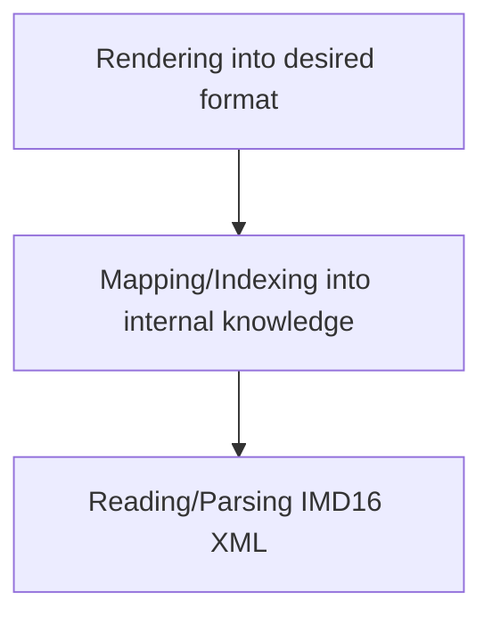

Handling of IMD16 is split into 3 levels of processing:

The following table gives an overview about current status of the implementation:

|             Name              |                 Features implemented                 | Coverage |                                                                          Comment                                                                          |
|:-----------------------------:|:----------------------------------------------------:|:--------:|:---------------------------------------------------------------------------------------------------------------------------------------------------------:|
|         Reading IMD16         |                   ⏳ (125/126)                    |   ~99%   | All constructs out of `ilisMeta16.ili` (version 2022-04-28) exported by ili2c 5.6.9 can be read into Python see [Reading IlisMeta16](ilismeta16.md) |
|         Index Mapper          |                    ⏳ (12/21)                     |   ~57%   |                                                  Ongoing DEV process see [Index Mapper](index_mapper.md)                                                  |
| Python Classes (renderer) | ✅ (13/13 mandatory) (17/18 incl. nice to have) |   100%   |                    Coverage of the mandatory requirements. Reads and writes XTF 2.3 and 2.4, see [Python Classes](python_classes.md)                    |
|  UML Diagrams (renderer)  |  ✅ (6/6 mandatory) (9/11 incl. nice to have)  |   100%   |                          Coverage of the mandatory requirements. Demonstrator tool, see [UML Diagrams](diagrams.md)                           |
