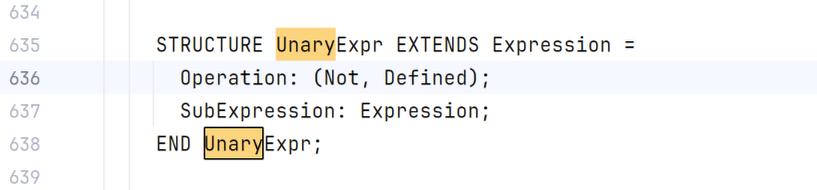
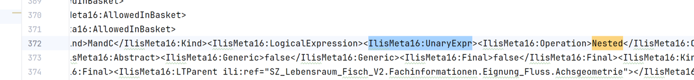

**Used ili2c version: 5.6.9**

During the intense work with IMD16 which were produced by ili2c, some questions came up. These are
summarized here. These Questions are not exclusively related to the compiler but may also be related
to the [Reference Manual of INTERLIS 2.4](https://github.com/rudert-geoinformatik/ili2py/blob/master/tests/data/ilismeta16/STAN_d_DEF_2024-04-24_eCH-0031_V2.1.0_INTERLIS_2-Referenzhandbuch.pdf)

## Open

### Difference of mandatory and multiplicity

It came to attention, that types carry both information `multiplicity` and `mandatory`. Even if these
serves different purposes and they are correctly set, it seems a bit awkward having both. ili2py
trades this information transparently forward. However, it might be a good idea to overcome this in the
next iteration of INTERLIS.

### OIDs are not transported comprehensible

When a topic of one model (B) extends a topic of another model (A) which defines an OID on topic level
(`OID AS ...`), no OID is present on the classes of the topic in model B.

Example is: OeREBKRM_V2_0 and OeREBKRMtrsfr_V2_0 where OeREBKRMtrsfr_V2_0 defines topic Transferstruktur
extending OeREBKRM_V2_0.Dokumente. OeREBKRM_V2_0.Dokumente defines `OID AS OEREBOID;` but all classes from
OeREBKRMtrsfr_V2_0.Transferstruktur have no `Oid` in the resulting IMD16.

ili2c (`Imd16Generator`) takes the OID of the class itself or of the topic the class is defined in
(`Topic.getOid()`). The OID of an extended topic is not taken into account.

### IlisMeta16.Operation 'Nested' in IlisMeta16.UnaryExpr

Ili model IlisMeta16 defines:

But imd16 generated with ili2c (still with 5.6.9) delivers an operation 'Nested':

ili2c writes it on purpose for expressions in brackets (`Imd16Generator`, `Expression.Subexpression`).
ili2py passes the value through as it is.

Example models:
- SZ_Lebensraum_Fisch_V2
- Wildruhezonen_V2_1
- KbS_V1_5
- Naturereigniskataster_MGDM_V1
- DMAVTYM_Alles_V1_1
- ...

### How are the geometric overlaps constraint unit transported in IlisMeta16?

Currently, we can have IlisMeta16:LineType.IlisMeta16:MaxOverlap in IlisMeta16 but it's not clear where the
unit is coming from.

Not sure if this is relevant, because there is also no unit defined in e.g. GeometryCHLV95_V1

## Solved

### Missing Topic ilisMeta16.ModelTranslation in IMD16

Issue created: https://github.com/claeis/ili2c/issues/149
=> solved with ili2c 5.6.7, translated models are written as `ModelTranslation` basket only

### Version of ModelData.Model not in IMD16 (2.4)

When creating IMD16 with ili2c 5.6.6 from 2.4 Models (e.g. Waldreservate_V2_0), the element
`ModelData.Model.Version` was missing.
=> solved, ili2c 5.6.9 writes it

### Missing INTERLIS.UTC.Hours in IMD16

It seemed that several pieces of the INTERLIS model are missing, `INTERLIS.UTC.Hours` was cited as an example.
=> not missing, `INTERLIS.UTC` extends `INTERLIS.TimeOfDay` which defines `Hours`
(`INTERLIS.TimeOfDay.Hours`). Inherited attributes are not repeated in the IMD16.

### Potentially missing IlisMeta16.ExistenceDef in imd16 exports

ili2c 5.6.6 seemed to miss the ExistenceDef association in imd16 exports.
=> not missing, ili2c 5.6.9 writes it embedded in `ExistenceConstraint.RequiredIn` (e.g. DMAVTYM_Alles_V1_0,
DMAVTYM_Tous_V1_1). The empty `ExistenceDefType` in the XSD is correct, the association has no attributes.

### Potentially missing IlisMeta16.EnumAssignment in imd16 exports

ili2c 5.6.6 seemed to miss the EnumAssignment in imd16 exports.
=> not missing, ili2c writes it as part of an `EnumMapping` (conditional expression). None of the test models
uses this construct.

### Encoding of directed polylines

It was not clear how a directed polyline is encoded in XTF.
=> there is no own encoding. The direction is given by the order of the vertices, which has to be kept
(also in a transfer), see reference manual 2.3 chapter 2.8.12.2 and 2.4 chapter 3.8.12.2.
