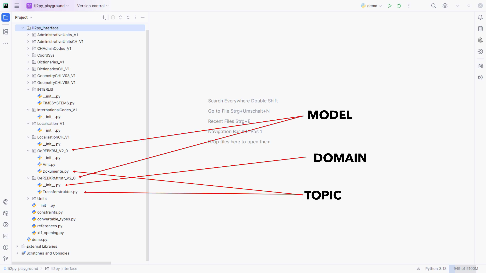
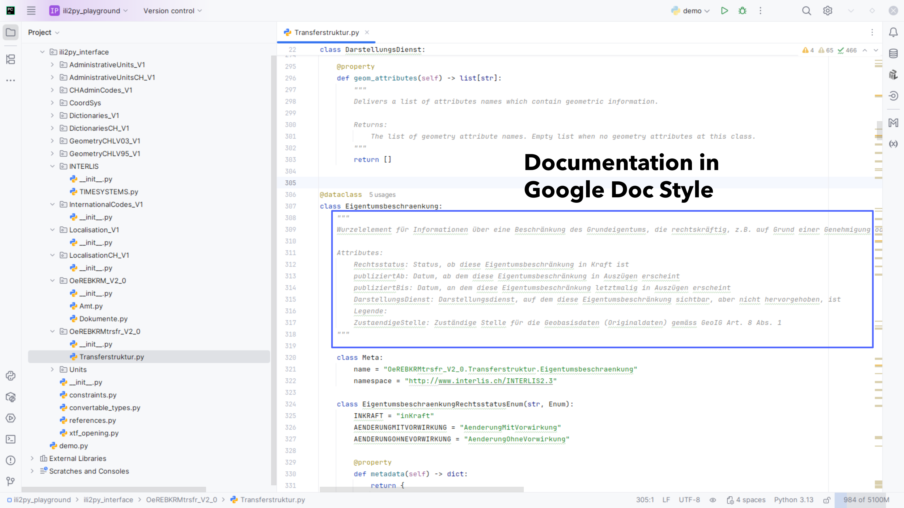
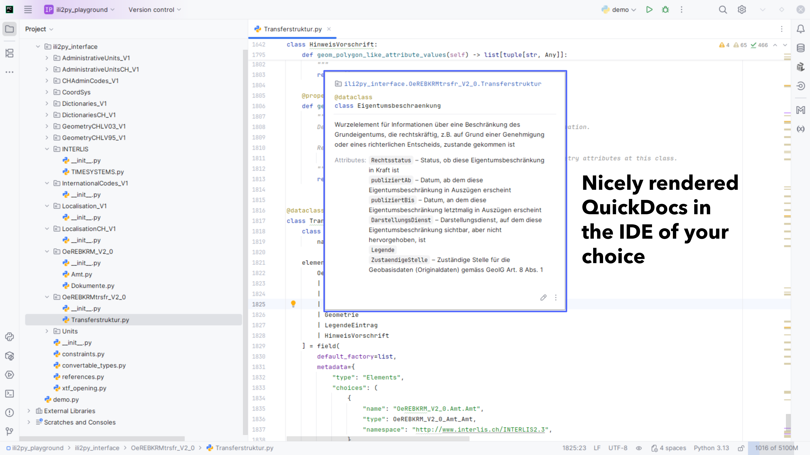
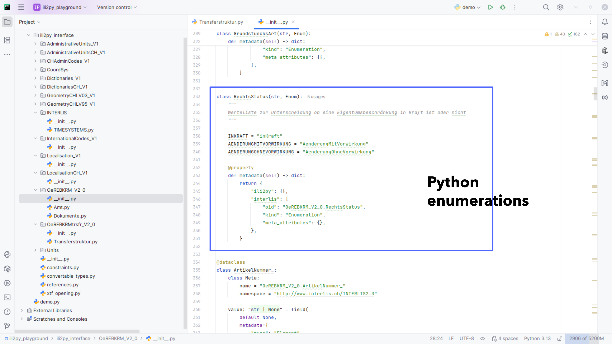
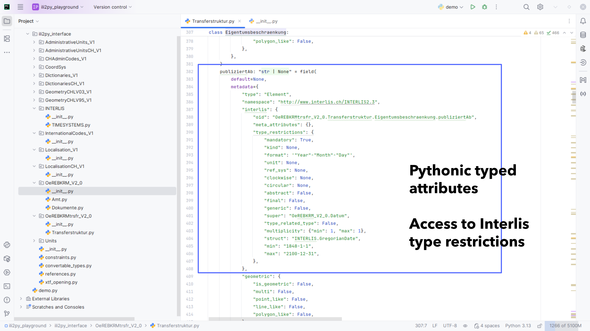
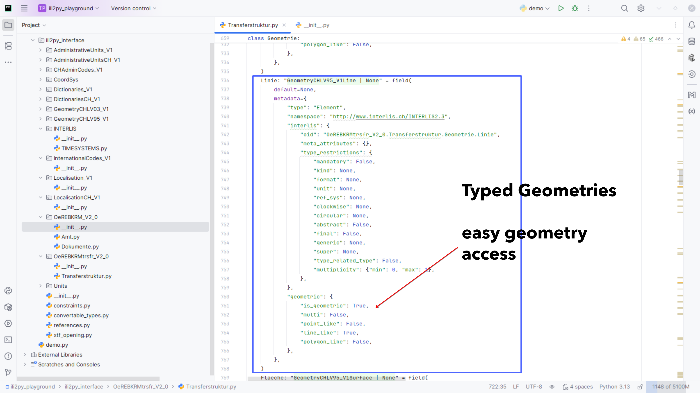
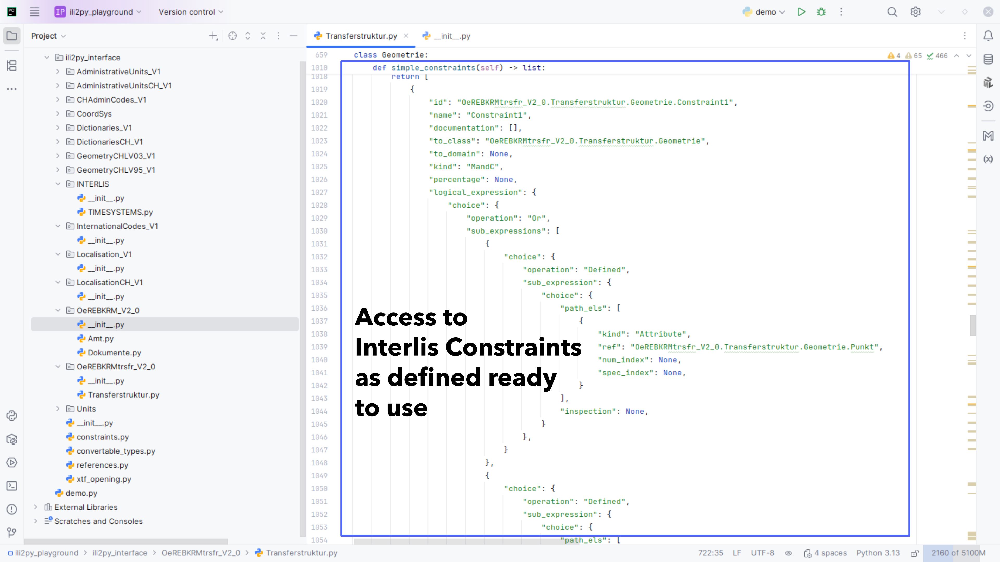
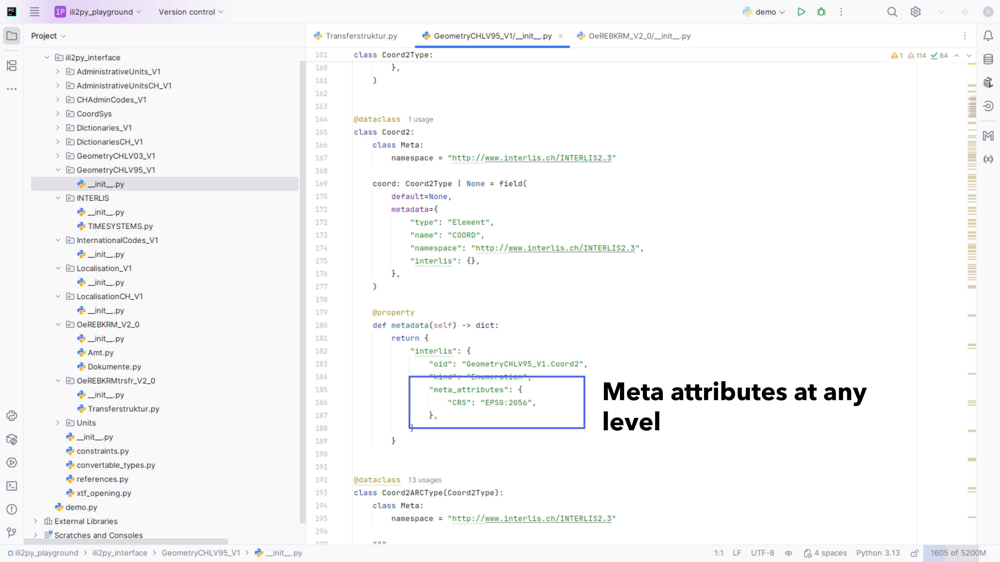

This program generates a standalone and fully typed python library from IMD16. The following section gives
an overview about the why and how.

## Intro

All started back in 2023 with some quick and dirty prototypes and lead to a [report](../documents/report/report.md).
This was backed by the cantons Neuchâtel and Basel-Landschaft.

One outcome back then was that dataclasses are the best toolset to describe data structures in python. Because it is
natively embedded and offers a wide range of flexible subsequent usage.

The idea was born to reflect the constructs of an Interlis model (ili) with those python dataclasses.

We could directly build a compiler with antlr in python to read those ili files into python structures.
Topping up only what we need one after another. That would have been the easy way.

We decided to go the hard way and implement the knowledge of the [Interlis IlisMeta16 Model](https://www.interlis.ch/modelle/metamodell) first instead.
in terms of sustainability this would be the right way to do. (And it is the dedicated usecase for the metamodel.)

## The library

The library created by **_ili2py_** is fully self containing. That means, once created it has the full knowledge of
the Interlis model and all subsequent dependencies. That is a really important point. You can use the resulting library
in your python code without any dependencies. Not even **_ili2py_** itself. The only thing you need is a python interpreter
(3.12+ recommended). Reading and writing XTF with it is part of **_ili2py_**, see
[Reading and writing XTF](#reading-and-writing-xtf).

### Structure

Its structure is a normal pythonic structure. Each model is defined in a sub package (folder) of the library. Each topic is a
python module (python file) in its model folder. Domain definitions are stored in the `__init__.py` files.



### Documentation

All documentation is transparently transported to its python twins.



The inline documentation follows the widely known and used GoogleStyle which offers a supreme readability
in the code itself. But also is supported in all major IDE's out of the box.



!!! info
    Using the GoogleStyle py doc strings also enables seamless integration in automatically built documentations.

### Value lists

Value lists are implemented as pure python enumerations and are therefore perfectly prepared for native subsequent usage.



### Types

The whole library is typed. Types are self containing in the libraries network of linked dataclasses. However,
at the end of each tree path there is a native pythonic type. **No external types are used.**
Besides the types itself the library also transparently transports the information about type restrictions and formats
from the interlis model.
Associations are typed as references to keep the tree clean and avoid circular dependencies.



### Geometries

Geometries are a core feature of interlis. One goal of the built library is to give easy and comfortable access to the
geometric elements in the model. So each class can provide info about its geometric attributes. And each geometric
attribute can provide detailed information about its kind of geometry. This is a good preparation for tools which
subsequently will use **_ili2py_** later.



### Constraints

The detailed implementation of constraints is another key feature in interlis. Since **_ili2py_** does not validate
anything, constraints are only transported as information at its dedicated pythonic twin elements. The model
of the constraints mirrors the IlisMeta16 model constraints part. Classes to interpret this part are delivered in the
library as well.



### MetaAttributes

These things are often used to implement behaviour which was not intended by interlis in the first place. The information
is forwarded to each pythonic twin transparently.



### Translations

Models can be translated into other languages (`TRANSLATION OF`). The translated names are forwarded to each pythonic
twin as well. Classes, attributes, topics, models, domains and constraints carry them in their metadata, the key is the
language code. Members of value lists carry them in `translations`.

The translations are only in the IMD if it was compiled for the translated model. ili2c (>= 5.6.7) then writes the
original model and its translation, e.g. compiling the INTERLIS 2.4 model `DMAVTYM_Tous_V1_1` gives:

```python
from ili2py_interface.DMAV_Bodenbedeckung_V1_1.Bodenbedeckung import Bodenbedeckung

print(Bodenbedeckung().metadata["interlis"]["translations"])
# {'fr': 'CouvertureSol'}
```

The library is always built from the original model. So the python names (packages, modules, classes, fields, members
of value lists) are always the ones of the original model, regardless of which model the IMD was compiled for.

### Translated models in INTERLIS 2.3 and 2.4

The transfer of a translated model differs between the INTERLIS versions:

| INTERLIS | Tags and values in the transfer                                                                                       | Library                                                                                             |
|----------|-----------------------------------------------------------------------------------------------------------------------|-----------------------------------------------------------------------------------------------------|
| 2.3      | in the language of the translated model<br/>(reference manual 2.3, 3.3.3)                                             | reads and writes the tags and values of the translated model, if the IMD contains its translation  |
| 2.4      | always in the language of the original model, the format does not change<br/>(reference manual 2.4, 4.3.3)            | reads and writes the tags and values of the original model                                          |

For INTERLIS 2.3 this means: create the library from the IMD of the model the data is delivered in. If the data is
delivered in the French model `PlanDirecteurEnergiesRenouvelables_V1`, compile that one. The library then reads and
writes `<PlanDirecteurEnergiesRenouvelables_V1.Objets.Objet>` and the value `Donnees_de_base`, while you still work with
the python class `Objekt` and the member `Objektart.AUSGANGSLAGE`. The translations turn around in this case, they
contain the name of the original model:

```python
from ili2py_interface.RichtplanungErneuerbareEnergien_V1 import Objektart

print(Objektart.AUSGANGSLAGE.value)
# Donnees_de_base
print(Objektart.AUSGANGSLAGE.translations)
# {'de': 'Ausgangslage'}
```

This applies to every model in the IMD which is translated, also to imported ones. Models without translation keep
their tags.

!!! note
    If an IMD contains more than one translation of the same model, the tags of the original model are kept, since the
    IMD does not tell which language the transfer uses. The alias table of the header (reference manual 2.3, 3.3.4) is
    not written, it is optional and only needed for polymorphic reading.

## Reading and writing XTF

The library can be used to read and write XTF. The classes do not know how, they only describe the elements (names and
namespaces in the field metadata). Reading and writing is the task of a backend in **_ili2py_**
(`ili2py.readers.xtf`), the library itself stays free of it. The entry point is the class `Transfer` in the module
`xtf_opening` of the library. ili2py shows only one way how to read the data. Other ways are possible
and can be implemented. So you can use this way of reading or take it as an inspiration to create your
own reader optimized for your own needs

| Module                               | Content                                                                                       |
|--------------------------------------|-----------------------------------------------------------------------------------------------|
| `ili2py.readers.xtf.xsdata_backend`  | `XsdataBackend`, the backend based on [xsdata](https://xsdata.readthedocs.io) and lxml        |
| `ili2py.readers.xtf.converters`      | `registered_converters`, registers the types of the library which xsdata does not know       |
| `ili2py.readers.xtf.geometry`        | the compact geometry types, see [Compact geometry](#compact-geometry)                         |
| `ili2py.readers.xtf.geometry_parser` | the second pass building the compact geometry                                                 |
| `ili2py.readers.xtf.backend`         | `XtfBackend`, the interface of a backend                                                      |

```python
from ili2py.readers.xtf.xsdata_backend import XsdataBackend
from oereb.xtf_opening import Transfer

backend = XsdataBackend()
transfer = backend.read("data.xtf", Transfer)

with open("written.xtf", "w", encoding="UTF-8") as out:
    backend.write(transfer, out)
```

It takes the xsdata configuration (`parser_config` / `serializer_config`) as optional argument, `write` also the
namespace prefixes (`ns_map`, key `None` is the default namespace).

### Registering the types of the library

xsdata only binds its known types, dataclasses and enumerations. The genersted library dataclassses uses some own types on top:

- the special str, int and float types of the domains (e.g. `INTERLIS.UUIDOID`, `INTERLIS.GregorianYear`), listed in
  `convertable_types.py`
- `BLACKBOX BINARY`, it is base64 encoded in the XTF

Without registering them, reading fails, e.g. on a TID typed as `INTERLIS.UUIDOID`. `XsdataBackend` registers them for
the time of a call. Using xsdata directly, `registered_converters` registers them for the time of the `with` block, the
argument is the name the library is imported with:

```python
from xsdata.formats.dataclass.parsers import XmlParser

from ili2py.readers.xtf.converters import registered_converters
from oereb.xtf_opening import Transfer

with registered_converters("oereb"):
    transfer = XmlParser().parse("data.xtf", Transfer)
```

!!! warning
    The converter registry of xsdata is global per process, `registered_converters` and `XsdataBackend` are not thread
    safe.

### Compact geometry

Each geometry element (`COORD`, `POLYLINE`, `SEGMENTS`, ...) is a dataclass of the library. xsdata binds every XML
element on its own, an XTF with surfaces consists mostly of `COORD`, `C1` and `C2` elements, so binding them dominates
the time of reading and writing. Read with `XsdataBackend(compact_geometry=True)`, each geometry (`COORD`, `POLYLINE`,
`SURFACE`, `MULTI*`) becomes one compact value instead, it does not go through xsdata. The classes stay the same, the
field holds the compact value while its annotation names the geometry dataclass. The written XTF is the same.

**On geometry heavy data, reading gets 8 to 14 times faster and writing 13 to 32 times faster.**

| Model                                                                            | XTF     | Objects | Geometry elements | Read       | Read compact | Write      | Write compact |
|----------------------------------------------------------------------------------|---------|---------|-------------------|------------|--------------|------------|---------------|
| Hazard_Mapping_V1_3  | 115 MB  | 14 285  | 98 %              | 69.8 s     | 4.8 s (×14)  | 102.8 s    | 3.2 s (×32)   |
| Grundwasservorkommen_V2_0                                                        | 34 MB   | 3 208   | 98 %              | 10.9 s     | 1.2 s (×9)   | 16.5 s     | 1.1 s (×15)   |
| Fruchtfolgeflaechen_V1                                                           | 8 MB    | 1 252   | 99 %              | 3.4 s      | 0.4 s (×8)   | 5.1 s      | 0.4 s (×13)   |

The gain depends on the share of the geometry, not on the size of the XTF. The objects and their attributes are still
bound by xsdata one element after another. Data with many objects and little geometry profits much less, without
geometry not at all:

| Model                                    | XTF     | Objects | Geometry elements | Read       | Read compact | Write      | Write compact |
|------------------------------------------|---------|---------|-------------------|------------|--------------|------------|---------------|
| Gewaesserraum_V1_1                       | 128 MB  | 66 960  | 68 %              | 54.4 s     | 20.0 s (×2.7)| 76.0 s     | 20.4 s (×3.7) |
| SIA405_LKMap_2015_2_d (Leitungskataster) | 91 MB   | 111 092 | 31 %              | 26.0 s     | 18.8 s (×1.4)| 29.5 s     | 18.8 s (×1.6) |
| SZ_Lebensraum_Fisch_V2                   | 2 MB    | 5 345   | 0 %               | 0.21 s     | 0.21 s (×1.0)| 0.28 s     | 0.26 s (×1.1) |

!!! info
    Measured with the test data in `tests/data/models` (fastest of 3 runs, in memory, without creating the library),
    python 3.12, xsdata 26.10, lxml 6.1. Geometry elements is the share of all XML elements of the XTF which belong
    to a geometry (`COORD`, `C1`, `ARC`, `POLYLINE`, ...). Measured with compact geometry types in the library, the
    predecessor of the second pass; Hazard_Mapping_V1_3 read with the second pass: 4 to 5 s.

The compact geometry is built in a second pass after xsdata bound the objects.

The geometry values are:

| Type            | Values                                                                                                                       |
|-----------------|------------------------------------------------------------------------------------------------------------------------------|
| `Coord`         | `coordinates`, a tuple of the axes                                                                                           |
| `Polyline`      | `coords`, the vertices flat (x1, y1, x2, y2, ...), `dimension`, `arcs` (key is the vertex ending an arc, value the arc point and the radius if given), `vertex(index)` |
| `Surface`       | `boundaries`, a list of `Polyline`, the first one is the exterior                                                            |
| `MultiPolyline` | `polylines`, a list of `Polyline`                                                                                            |
| `MultiSurface`  | `surfaces`, a list of `Surface`                                                                                              |

The type of the value of a field carries the `spec` of its coord type: the axes, their python types and precisions.
The parts inside (e.g. the boundaries of a surface) are plain `Polyline`.

```python
for basket in transfer.datasection.baskets:
    for element in basket.elements:
        # the SURFACE attribute Flaeche of the OeREB model
        flaeche = getattr(element, "Flaeche", None)
        if flaeche is not None:
            exterior = flaeche.boundaries[0]
            print(len(exterior), exterior.vertex(0), flaeche.spec.precisions)
            # 12 (2682494.504, 1258951.958) (3, 3)
```

!!! note
    The values are `float`, `float(text)` keeps the value of the XTF exactly. `XsdataBackend` writes them as xsdata
    writes floats.

### Own backend

`XsdataBackend` is a suggestion, not a must. Any class with the methods of `XtfBackend` (`ili2py.readers.xtf.backend`)
is a backend, e.g. one based on the standard library or a streaming one for huge transfers. It has to know the field
metadata of the dataclasses (`name`, `namespace`, `type`, `geometric`):

```python
from io import TextIOBase
from pathlib import Path
from typing import IO, Any

from ili2py.readers.xtf.backend import XtfBackend


class MyBackend:
    def read(self, source: str | Path | IO[bytes], transfer_class: type) -> Any:
        # parse the XTF, bind the elements by the field metadata
        ...

    def write(
        self, transfer: Any, out: TextIOBase, ns_map: dict[str | None, str] | None = None
    ) -> None:
        ...


assert isinstance(MyBackend(), XtfBackend)
```

The geometry types take their values positionally, as listed in the table above, e.g. `Polyline(coords, dimension,
arcs)` with `coords` as `array("d")`. `Polyline.with_spec(spec)` creates the type carrying the `spec` of the axes, it
keeps the name `Polyline`.

The element names of the geometry differ between the transfer versions: INTERLIS 2.3 writes them in capitals in its one
namespace (`COORD`, `C1`), INTERLIS 2.4 in lower case in the namespace `geom` (`geom:coord`, `geom:c1`) and adds the
multi geometries. A backend does not need to spell them out, they are ready in `Ili23GeometryTags`
(`ili2py.interfaces.interlis.interlis_23`) and `Ili24GeometryTags` (`ili2py.interfaces.interlis.interlis_24`). Both
extend `GeometryTags` (`ili2py.interfaces.interlis`), which tells by `reads(transfer_class)` if a transfer belongs to
its version:

```python
from ili2py.interfaces.interlis.interlis_23 import Ili23GeometryTags
from oereb.xtf_opening import Transfer

# the OeREB transfer model is INTERLIS 2.3
print(Ili23GeometryTags.reads(Transfer))
# True
tags = Ili23GeometryTags()
print(tags.coord, tags.boundary(0))
# {http://www.interlis.ch/INTERLIS2.3}COORD {http://www.interlis.ch/INTERLIS2.3}BOUNDARY
```
